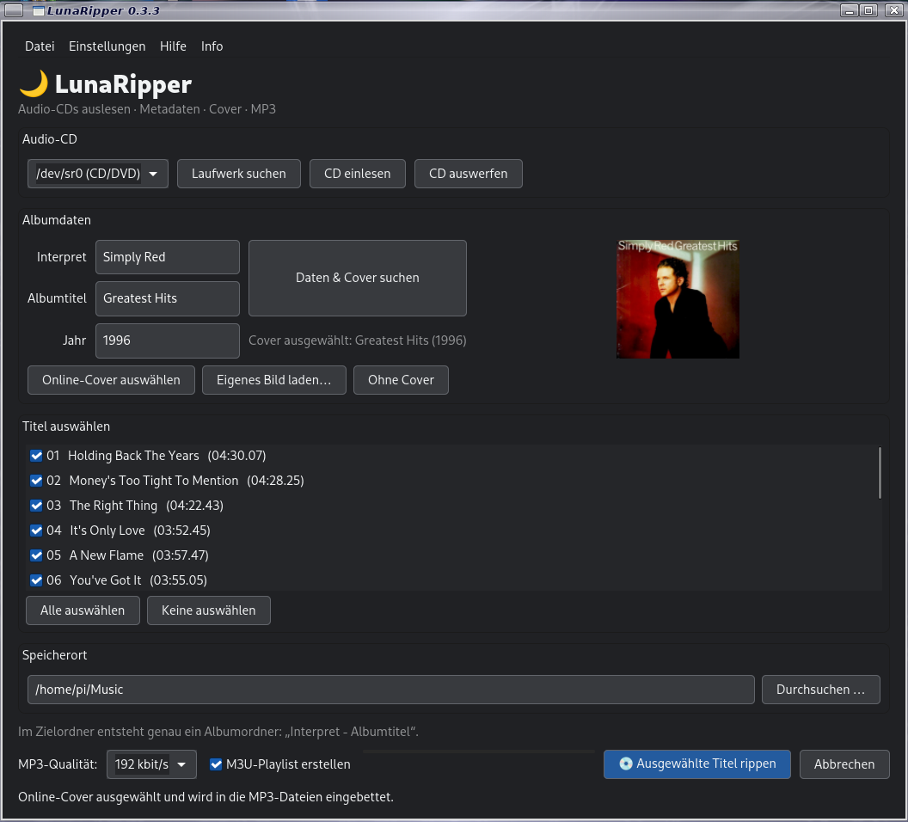

# LunaRipper 0.3.3

LunaRipper ist ein Audio-CD-Ripper für Linux. Die Anwendung nutzt GTK 4 für die Oberfläche, `cdparanoia` zum Auslesen der Audio-CD und LAME zur MP3-Erstellung.



[Github Seite](https://github.com/Angonikro/LunaRipper/)

## Funktionen

- Optische Laufwerke unter `/dev/sr*` automatisch erkennen, zum Beispiel `/dev/sr0` oder `/dev/sr1
- Laufwerk in der Anwendung auswählen und die Geräteliste bei Bedarf aktualisieren
- CD-Schublade über die Schaltfläche **CD auswerfen** öffnen
- Einzelne Titel oder alle Titel einer Audio-CD rippen
- Optional per Kontrollkästchen eine M3U-Playlist im Albumordner erstellen; standardmäßig deaktiviert und erst nach dem Rippen geschrieben
- CD in einem zusammenhängenden Lesevorgang auslesen, statt `cdparanoia` für jeden Titel neu zu starten
- MP3-Qualität mit 320, 256 oder 192 kbit/s auswählen
- CD-Informationen automatisch über einen cddb Anbieter abfragen, sofern ein passender Eintrag vorhanden und der Dienst erreichbar ist
- Albumdaten manuell eingeben und Metadaten über MusicBrainz suchen
- Online-Cover aus dem Cover Art Archive ansehen und gezielt auswählen
- Eigenes Cover (JPEG, PNG oder WebP) verwenden oder ausdrücklich ohne Cover rippen
- Cover im Albumordner speichern und in MP3-Dateien einbetten
- Zielordner über einen Ordnerdialog auswählen
- Album in einem einzigen Ordner `Interpret - Albumtitel` speichern
- Lesefehler-Einstellungen mit zusätzlichen Leseversuchen und optionalem Rettungsversuch
- Vorhandene MP3-Dateien nicht überschreiben
- MP3-Dateien direkt unter dem endgültigen Dateinamen erstellen; keine zusätzliche temporäre MP3-Datei und kein Hardlink-Schritt
- Musik-Zielordner automatisch ermitteln, bevorzugt anhand der XDG-Musikordner-Einstellung

## Voraussetzungen

Vorgesehen für Debian 13 und Raspberry Pi OS mit Desktop. Benötigt werden Python 3, GTK 4, PyGObject, Mutagen, `cdparanoia`, `cd-discid` und LAME.

Installation der Abhängigkeiten:

```bash
sudo apt update
sudo apt install python3 python3-gi gir1.2-gtk-4.0 python3-mutagen cdparanoia cd-discid lame eject
```

Alternativ im Projektordner:

```bash
./install_deps.sh
```

## Start aus dem Quellcode

ZIP-Datei entpacken, in den Ordner `LunaRipper` wechseln und starten:

```bash
python3 lunaripper.py
```

## CD-Laufwerk auswählen

LunaRipper sucht automatisch nach optischen Laufwerken unter `/dev/sr*`. Das gefundene Laufwerk wird in der Auswahlliste der Anwendung angezeigt. Wird ein Laufwerk nach dem Anschließen oder Einlegen einer CD nicht angezeigt, **Aktualisieren** anklicken.

Normalerweise muss dafür nichts in `lunaripper.py` geändert werden. Nur bei einer ungewöhnlichen Geräte-Konfiguration, die nicht unter `/dev/sr*` erscheint, wäre eine Anpassung des Programms nötig.

## Metadaten und Cover

Die automatische CD-Erkennung verwendet GNUDB über das CDDB-kompatible Protokoll. Ein Treffer ist nicht für jede CD garantiert. Die Verbindung kann außerdem von der Erreichbarkeit des Servers und den in den CDDB-Einstellungen hinterlegten Werten abhängen.

MusicBrainz wird für die Suche anhand manuell eingegebener Interpret- und Albumdaten verwendet. Cover werden über das Cover Art Archive gesucht und vor dem Übernehmen zur Auswahl angezeigt. Eine Internetverbindung ist für diese Funktionen erforderlich.

## Rippen und Lesefehler

Beim Rippen liest `cdparanoia` die CD in einem zusammenhängenden Vorgang aus. Anschließend werden die ausgewählten Titel in MP3 umgewandelt. Die Dauer hängt unter anderem von Laufwerk, CD-Zustand und eingestellten Wiederholungsversuchen ab.

Unter **Einstellungen → Lesefehler** können zusätzliche Leseversuche eingestellt werden. Die Option **Lesefehler ignorieren** ist standardmäßig ausgeschaltet. Ist sie aktiviert, kann LunaRipper nach fehlgeschlagenen normalen Leseversuchen einen weniger strengen Rettungsversuch starten. Dabei können beschädigte oder fehlende Audiodaten entstehen. Wenn das Laufwerk selbst nicht mehr reagiert, kann auch der Rettungsversuch scheitern.

## Hinweise

- Eine Audio-CD muss eingelegt sein.
- Der angemeldete Benutzer benötigt gegebenenfalls Berechtigungen für den Zugriff auf das optische Laufwerk.
- Vorhandene MP3-Dateien werden nicht überschrieben.

73 de DO2QG Andreas
